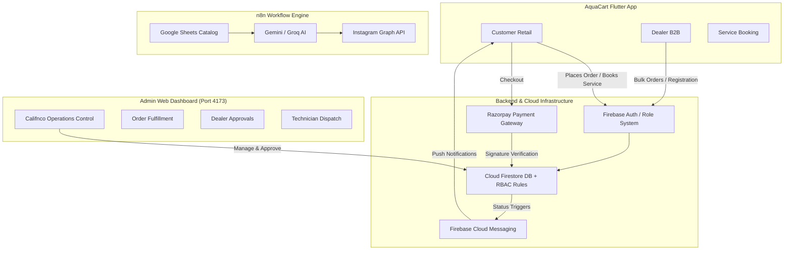
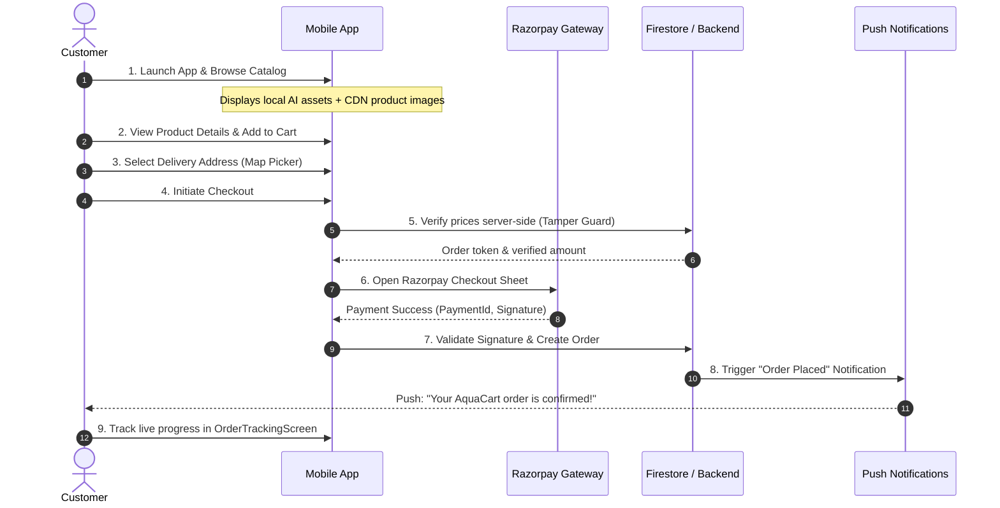
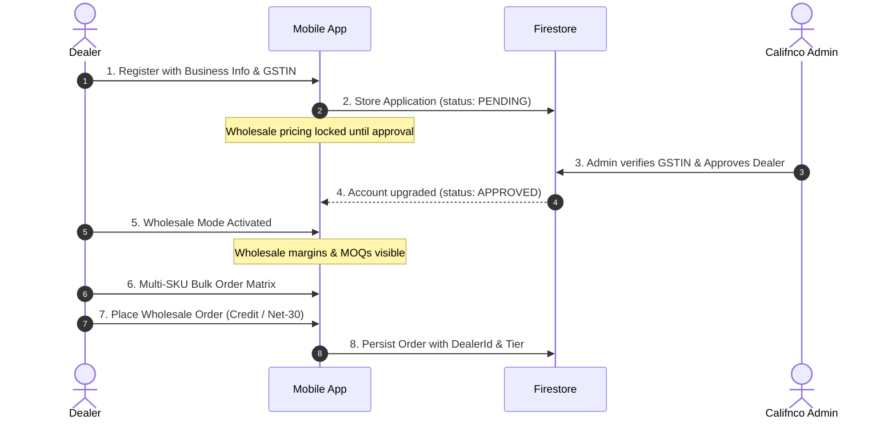
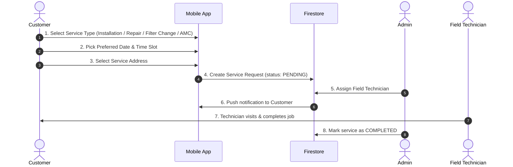
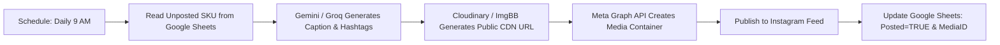

# AquaCart (Califnco) — Complete End-to-End System Workflow

```
┌──────────────────────────────────────────────────────────────────────────────────┐
│                               AquaCart Ecosystem                                 │
├───────────────────────┬─────────────────────────┬────────────────────────────────┤
│  Flutter Mobile App   │   Admin Web Dashboard   │      Automations & Cloud       │
│  (Customer & Dealer)  │     (React + Vite)      │    (Firebase, Razorpay, n8n)   │
└───────────────────────┴─────────────────────────┴────────────────────────────────┘
```

---

## 1. System Architecture Overview

AquaCart is an enterprise-grade water purification commerce and service platform operating across three primary user roles, an administrative command center, and cloud automation:



---

## 2. Customer Retail Workflow



### Step-by-Step Customer Journey:
1. **Catalog Exploration**:
   - Customer opens AquaCart and sees featured RO purifiers with high-definition visuals.
   - Products are categorized: Domestic RO, Commercial Plants, Filters & Membranes, Spare Parts.
2. **Product Detail View**:
   - Full technical specifications (purification capacity, stages, TDS range, recovery rate).
   - Price calculation, warranty terms, and stock status.
3. **Cart & MOQ Check**:
   - Customer adds units to cart. Retail orders have a Minimum Order Quantity (MOQ) of 1.
4. **Address & Delivery**:
   - Integration with Google Maps / GPS address picker to ensure accurate pin locations.
5. **Secure Payment (Razorpay Test Mode)**:
   - Client requests order creation.
   - Prices are recalculated from trusted catalog data (preventing client-side price tampering).
   - Razorpay sheet handles card, UPI, or net banking in test mode.
   - Cryptographic signature (`hmac_sha256`) is verified before order status is marked as `PAID`.
6. **Live Order Tracking**:
   - Customer monitors order stages: `Placed` ➔ `Confirmed` ➔ `Dispatched` ➔ `Delivered`.

---

## 3. Dealer B2B Wholesale Workflow



### Step-by-Step Dealer Journey:
1. **Dealer Onboarding**:
   - Dealer submits company name, trade license, GST number, and delivery hub address.
   - Initial status is `Pending`. During this phase, wholesale discounts cannot be claimed.
2. **Admin Verification**:
   - Califnco operations team reviews the application in the Web Dashboard and sets tier (`Silver`, `Gold`, `Platinum`).
3. **Wholesale Catalog Access**:
   - Once approved, the app displays discounted wholesale pricing (e.g. ₹9,450 vs ₹13,499 retail).
   - Each product enforces a wholesale Minimum Order Quantity (MOQ, e.g., 5 or 20 units).
4. **Bulk Order Matrix (`DealerBulkOrderScreen`)**:
   - Fast multi-SKU table where dealers select quantities across multiple filters and purifiers simultaneously.
   - Automatic live calculation of wholesale subtotal, 18% GST input tax credit, and volume margins.
5. **Dealer Order Isolation**:
   - Firestore security rules strictly constrain dealers to view *only* their own wholesale orders and authorized dealer tier pricing.

---

## 4. Service & Installation Workflow



### Service Categories:
- **New Purifier Installation**: Complimentary for new AquaCart buyers.
- **Filter & Membrane Replacement**: Scheduled based on TDS reading or calendar alert.
- **Emergency Repair & Leakage**: Priority technician dispatch within 4 hours.
- **Annual Maintenance Contract (AMC)**: Year-round coverage including 3 scheduled cleanings and membrane replacements.

---

## 5. Califnco Admin Web Operations Workflow

The Admin Dashboard runs as an independent web application at **`http://localhost:4173`**:

```
┌────────────────────────────────────────────────────────────────────────┐
│                      CALIFNCO ADMIN CONTROL PANEL                      │
├───────────────┬───────────────────┬─────────────────┬──────────────────┤
│ Total Revenue │  Customer Orders  │ Dealer Orders   │ Pending Approvals│
│  ₹ 4,82,500   │      124 Active   │    38 Bulk      │    4 New Dealers │
└───────────────┴───────────────────┴─────────────────┴──────────────────┘
```

### Core Operations in Admin Portal:
1. **Order Fulfillment Tab**:
   - View complete item breakdown with thumbnail product pictures.
   - Filter by customer retail vs dealer wholesale.
   - Update order status: Click to advance `Placed` ➔ `Confirmed` ➔ `Dispatched` ➔ `Delivered`.
2. **Dealer Application Tab**:
   - Review pending dealership applications with GSTIN and business credentials.
   - One-click **Approve** or **Reject** with tier assignment.
3. **Service Dispatch Tab**:
   - View requested services sorted by appointment date.
   - Assign local field technicians and record service completion.
4. **Inventory & SKU Catalog**:
   - View stock levels, retail pricing, wholesale pricing, and MOQs.

---

## 6. Daily Social Media Automation (n8n Workflow)

The automated marketing engine runs daily without manual intervention:



1. **Trigger**: Runs every morning at 9:00 AM IST.
2. **Filter**: Searches the product catalog for items where `Posted == FALSE`.
3. **AI Content Generation**: Generates high-converting marketing copy highlighting water health, TDS reduction, and current offers.
4. **Publishing**: Sends product image and caption to the official Instagram Business Account.
5. **Audit Logging**: Marks the row as published with post timestamp and Instagram Media ID to guarantee zero duplicates.

---

## 7. Security & Integrity Safeguards

| Component | Security Mechanism |
|---|---|
| **Pricing** | Server-side price recalculation guards against client-side tampering |
| **Payments** | Razorpay cryptographic HMAC SHA-256 signature verification |
| **Wholesale Access** | Dual-layer check: UI blocks non-approved users AND Firestore rules reject unauthorized wholesale orders |
| **Database** | Granular Firestore Security Rules restricting read/write access per role (`customer`, `dealer`, `admin`) |
| **Asset Delivery** | Tiered fallback (Local offline assets ➔ Cloudflare/Unsplash CDN ➔ Branded SVG/Vector icon) |
