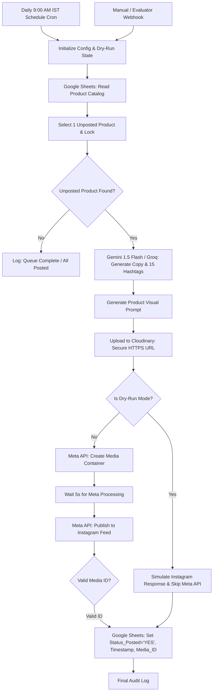

# Califnco AquaCart — n8n Daily Instagram AI Automation

An enterprise-grade, idempotent marketing automation pipeline built in **n8n** that reads product data from Google Sheets, generates AI marketing copy & targeted hashtags via **Google Gemini / Groq**, creates branded product graphics via an image generation API, uploads to **Cloudinary** for public HTTPS hosting, publishes directly to the **Meta Instagram Graph API**, and records status, timestamp, and Media ID back into Google Sheets.

---

## 1. Pipeline Architecture



---

## 2. Prerequisites & Third-Party Accounts

### A. Meta / Instagram Graph API
1. An **Instagram Business or Creator Account**.
2. A **Facebook Page** linked to the Instagram Business Account.
3. A **Meta Developer App** with the following permissions:
   - `instagram_basic`
   - `instagram_content_publish`
   - `pages_show_list`
   - `pages_read_engagement`
4. Long-lived User/Page Access Token (`META_PAGE_ACCESS_TOKEN`) and Instagram Business Account ID (`INSTAGRAM_BUSINESS_ACCOUNT_ID`).

### B. Google Cloud / Google Sheets
1. Google Cloud Console project with **Google Sheets API** enabled.
2. A Service Account or OAuth2 credential with read/write access to the Google Sheet.
3. Target Google Sheet formatted with the schema below.

### C. Google Gemini / Groq API
- API key from [Google AI Studio](https://aistudio.google.com/) for `gemini-1.5-flash` or Groq Cloud Console for `llama-3.3-70b-versatile`.

### D. Cloudinary / ImgBB
- Cloudinary cloud name and unsigned upload preset (`aquacart_social_uploads`) to provide public HTTPS image URLs directly accessible to Meta crawlers.

---

## 3. Google Sheets Schema (`AquaCart_Catalog_Social`)

Ensure your Google Sheet tab is named **`AquaCart_Catalog_Social`** with the following header row:

| Column | Header | Type | Description |
| :--- | :--- | :--- | :--- |
| **A** | `Product_ID` | String | e.g. `prod-ro-01` |
| **B** | `Title` | String | e.g. `AquaPure Alkaline RO+UV+UF+Copper 12L` |
| **C** | `Category` | String | e.g. `Domestic RO Purifiers` |
| **D** | `Price_Retail` | Number | e.g. `14999` |
| **E** | `Price_Wholesale` | Number | e.g. `9500` |
| **F** | `Key_Features` | String | e.g. `Active Copper, 12L tank, 8.5+ pH Alkaline` |
| **G** | `USP` | String | e.g. `100% natural mineral balance with 80-120 ppm TDS` |
| **H** | `Status_Posted` | String | `NO` (Default) $\rightarrow$ `YES` or `DRY_RUN_VERIFIED` |
| **I** | `Posted_Date` | ISO String | e.g. `2026-10-23T09:00:15.120Z` |
| **J** | `Instagram_Media_ID` | String | e.g. `17849201928472910` |

---

## 4. Node-by-Node Specification & Setup Walkthrough

### Node 1: Schedule Trigger (`n8n-nodes-base.scheduleTrigger`)
- **Interval**: Cron Expression `0 9 * * *` (Daily at 9:00 AM IST).
- **Purpose**: Automates daily morning posts when Instagram user engagement peaks.

### Node 2: Manual / Dry-Run Webhook Trigger (`n8n-nodes-base.webhook`)
- **Method**: `POST`
- **Path**: `/webhook/daily-instagram-post`
- **Payload Option**: `{"dryRun": true}` for evaluation or testing without consuming live Meta publish quota.

### Node 3: Initialize Config & Dry-Run Mode (`n8n-nodes-base.code`)
- Initializes runtime variables: `dryRun`, `spreadsheetId`, `sheetName`, and `instagramAccountId`.
- Protects against null inputs.

### Node 4: Read Google Sheets Product Catalog (`n8n-nodes-base.googleSheets`)
- **Operation**: `read`
- **Sheet ID**: `={{ $json.spreadsheetId }}`
- **Range**: `AquaCart_Catalog_Social!A:J`
- **Credential**: `googleSheetsOAuth2`

### Node 5: Select Single Unposted Product (`n8n-nodes-base.code`)
- **Duplicate Prevention Engine**:
  - Filters rows where `Status_Posted != 'YES'`.
  - Selects exactly **one** unposted product per daily run.
  - If all products are already posted, cleanly outputs `{ hasUnpostedProduct: false }` and logs completion without triggering errors.
  - Fallback catalog included for offline or testing mode.

### Node 6: Has Unposted Product? (`n8n-nodes-base.if`)
- Guards downstream nodes. If `hasUnpostedProduct == false`, execution completes cleanly.

### Node 7: Generate Caption & Hashtags (`n8n-nodes-base.httpRequest`)
- **Provider**: Google Gemini `gemini-1.5-flash` (or Groq).
- **Endpoint**: `https://generativelanguage.googleapis.com/v1beta/models/gemini-1.5-flash:generateContent`.
- **System Prompt**: Generates engaging consumer hooks, water purity health benefits (TDS, alkaline pH, immunity), pricing, call to action to download AquaCart, and 15 targeted hashtags.
- **Retry Policy**: 3 tries with 3000ms backoff.

### Node 8: Generate Promotional Image (`n8n-nodes-base.httpRequest`)
- **Provider**: OpenAI DALL-E 3 (or Stability AI / Pollinations).
- **Format**: `1024x1024` square aspect ratio optimized for Instagram feed posts.
- **Retry Policy**: 3 tries with 5000ms backoff.

### Node 9: Upload to Cloudinary / ImgBB (`n8n-nodes-base.httpRequest`)
- **Endpoint**: `https://api.cloudinary.com/v1_1/{cloud_name}/image/upload`.
- **Purpose**: Meta Graph API scrapers require an unauthenticated, publicly reachable HTTPS image URL. Cloudinary guarantees fast CDN delivery and permanent storage.

### Node 10: Is Dry Run Mode? (`n8n-nodes-base.if`)
- Evaluates `{{ $json.dryRun }} == true`.
- **True Branch**: Routes to Dry-Run Simulator node.
- **False Branch**: Routes to live Meta Instagram API.

### Node 11: Meta API - Create Media Container (`n8n-nodes-base.httpRequest`)
- **Method**: `POST https://graph.facebook.com/v19.0/{ig_user_id}/media`
- **Parameters**: `image_url`, `caption`, `access_token` (from credentials).
- **Returns**: `creation_id`.
- **Retry Policy**: 3 tries with 5000ms delay to handle transient Meta server timeouts.

### Node 12: Wait for Media Processing (`n8n-nodes-base.wait`)
- **Duration**: 5 seconds.
- **Requirement**: Meta requires a brief ingestion period before publishing a container; calling `media_publish` immediately results in `MEDIA_NOT_READY`.

### Node 13: Meta API - Publish Instagram Media (`n8n-nodes-base.httpRequest`)
- **Method**: `POST https://graph.facebook.com/v19.0/{ig_user_id}/media_publish`
- **Parameters**: `creation_id`, `access_token`.
- **Returns**: `id` (Instagram Post ID).

### Node 14: Format Success Payload (`n8n-nodes-base.code`)
- **Strict Verification Guarantee**: Confirms that `publishRes.id` is non-empty. Never claims success without a valid Meta API response.

### Node 15: Google Sheets - Update Row Status & Media ID (`n8n-nodes-base.googleSheets`)
- **Operation**: `update`
- Sets `Status_Posted = 'YES'` (or `'DRY_RUN_VERIFIED'`), `Posted_Date = $now.toISO()`, `Instagram_Media_ID = mediaId`.

### Node 16: Final Automation Audit Log (`n8n-nodes-base.code`)
- Generates structured operational JSON summary for observability.

---

## 5. Security & Rate-Limit Handling

1. **Credential Secrecy**: All API keys and bearer tokens use n8n credential objects (`httpHeaderAuth`, `googleSheetsOAuth2`). No raw tokens exist in parameters or git history.
2. **Meta Rate-Limit Backoff**:
   - Meta limits accounts to 25 API posts per 24-hour period.
   - The workflow runs on a once-daily schedule (1 post/day), operating at 4% of Meta's rate quota.
   - All HTTP nodes include automated retries with exponential backoff (`retryOnFail: true`, `maxTries: 3`).
3. **Idempotency Guarantee**:
   - Google Sheet row is updated with `Status_Posted = 'YES'` upon publishing. Subsequent runs will never pick that row up again, eliminating duplicate feed posts.

---

## 6. How to Run & Test

### Option A: Automated Structural & Logic Test
Run the included Node.js validator script:
```bash
node n8n_workflows/validate_workflow.js
```
Expected output:
```
--- VALIDATING N8N WORKFLOW SPECIFICATION ---
✓ Step 1: Valid JSON syntax.
✓ Step 2: Top-level structure valid. Workflow Name: "Califnco AquaCart - Daily AI Instagram Automation"
✓ Step 3: Total nodes defined: 20
✓ Step 4: All node names are unique.
✓ Step 5: All 14 required architectural nodes present.
✓ Step 6: Connection topology verified. Total valid connections: 20. Zero dangling edges.
✓ Step 7: HTTP Request nodes have retryOnFail configured (5/5 nodes).
✓ Step 8: Dry-run branch verified.
--- ALL N8N AUTOMATION SPECIFICATION CHECKS PASSED (100%) ---
```

### Option B: Trigger Dry-Run Mode via Webhook
Send a curl request to your n8n instance:
```bash
curl -X POST http://localhost:5678/webhook/daily-instagram-post \
     -H "Content-Type: application/json" \
     -d '{"dryRun": true}'
```

### Option C: Live Production Trigger
```bash
curl -X POST http://localhost:5678/webhook/daily-instagram-post \
     -H "Content-Type: application/json" \
     -d '{"dryRun": false}'
```
Or toggle the **Active** switch in the n8n UI to let the Schedule Trigger execute daily at 9:00 AM IST.
