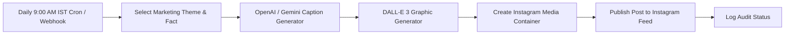

# AquaCart - n8n Daily AI Instagram Marketing Workflow

This automated workflow generates and posts daily educational and promotional content to the **AquaCart Instagram Business Account** using OpenAI/Gemini for marketing copy generation and the Meta/Instagram Graph API.

---

## Workflow Architecture



---

## Content Rotation Themes

The workflow rotates through 4 strategic marketing angles designed to drive app installs, service bookings, and dealer partnerships:

1. **TDS Health Awareness**: Explains dangerous levels of dissolved solids, kidney health, and why standard filters fail.
2. **Active Copper & Alkaline Health**: Highlights mineral loss in traditional RO and promotes AquaPure remineralizers.
3. **Monsoon Filter Care Guide**: Urges seasonal pre-filter replacements to protect domestic membranes from turbid tap water.
4. **B2B Dealer Wholesale Program**: Recruits regional water purifier dealers with wholesale margin and credit terms.

---

## Import & Setup Instructions

### 1. Import into n8n
1. Open your n8n workspace (self-hosted or n8n cloud).
2. Go to **Workflows** -> **Import from File**.
3. Select `daily_instagram_post_workflow.json`.

### 2. Configure Credentials
Add the following credentials in your n8n credential manager:
- **OpenAI API Key**: Set your `OPENAI_API_KEY` (requires DALL-E 3 and Chat Completion scopes).
- **Environment Variables**:
  - `INSTAGRAM_BUSINESS_ACCOUNT_ID`: Your Meta Professional account ID.
  - `META_PAGE_ACCESS_TOKEN`: Long-lived User/Page access token with `instagram_basic`, `instagram_content_publish`, and `pages_show_list` permissions.

### 3. Test & Activate
- Click **Execute Workflow** or send a POST request to the **Manual Test Webhook** URL:
  ```bash
  curl -X POST http://localhost:5678/webhook/test-instagram-publish
  ```
- Toggle the workflow toggle to **Active** to begin automated daily 9:00 AM postings.
